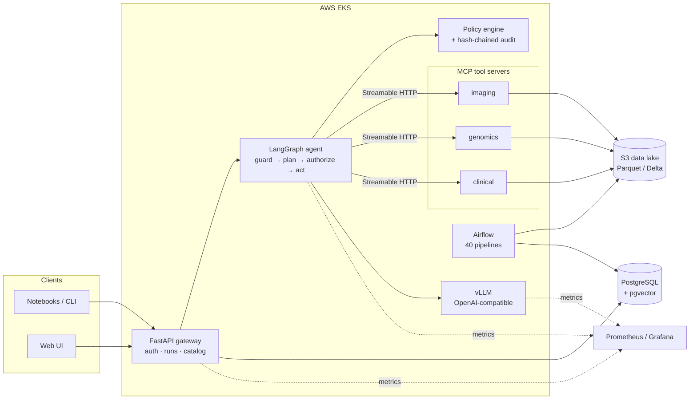

# SciAgent

**An AI enablement platform for scientific data and agentic workflows.**

SciAgent turns AI from one-off prototypes into a *reliable utility for researchers*: a
platform where scientists query, harmonise and analyse multimodal biological data
(imaging, genomics, clinical time series) through agentic workflows with governed tool
access to pipelines and models — with reproducibility, evaluation and auditability built in.

[](https://github.com/maxxrichard/SciAgent/actions/workflows/ci.yml)
[](https://github.com/maxxrichard/SciAgent/actions/workflows/eval-gate.yml)


`Python` · `Kubernetes` · `AWS EKS/S3` · `FastAPI` · `Airflow` · `LangGraph` · `MCP` ·
`PostgreSQL/pgvector` · `Terraform` · `GitHub Actions` · `vLLM` · `Prometheus/Grafana`

---

## Architecture



| Layer | What it does | Code |
|---|---|---|
| **API** | FastAPI service: API-key auth, agent runs, dataset catalog, direct tool calls, audit trail, RED metrics | [`src/sciagent/api`](src/sciagent/api) |
| **Agent** | LangGraph state machine. Every tool call is policy-checked and audited before execution; input/output guardrails on each run | [`src/sciagent/agent`](src/sciagent/agent) |
| **Tools / MCP** | 8 scientific tools (segmentation, image features, variant annotation, scRNA QC, vital-sign anomalies, cohorts, survival, lab harmonisation) served by 3 domain MCP servers | [`src/sciagent/tools`](src/sciagent/tools), [`src/sciagent/mcp_servers`](src/sciagent/mcp_servers) |
| **Governance** | Attribute-based tool policy (role × data group × budget), PII / prompt-injection guardrails, numeric-grounding checks, tamper-evident audit log | [`src/sciagent/governance`](src/sciagent/governance) |
| **Data** | 40 declarative pipelines (extract → validate → publish → register) to a Parquet/Delta lake on S3, versioned and checksummed in the catalog; Airflow DAGs generated from the same specs | [`src/sciagent/data`](src/sciagent/data), [`dags/`](dags) |
| **Retrieval** | Embeddings over tool docs and dataset descriptions, pgvector (HNSW) in production, in-memory locally | [`src/sciagent/retrieval`](src/sciagent/retrieval) |
| **Evaluation** | Curated task suite, automatic checks, LLM-as-judge, human-review queue and a release gate that blocks deploys | [`src/sciagent/eval`](src/sciagent/eval), [`evals/`](evals) |
| **Infra** | Terraform (VPC, EKS with GPU node group, S3, RDS, IRSA), Helm chart, Prometheus SLO rules, Grafana dashboards | [`infra/`](infra), [`deploy/`](deploy) |

Design decisions are recorded as ADRs in [`docs/adr`](docs/adr).

## Quickstart

Requires Python 3.11+ (and optionally Docker).

```bash
make install          # creates .venv and installs sciagent[dev]
make test             # pytest with a 90% coverage floor
make eval             # run the evaluation suite against the release gate
```

Ask the agent a question locally — no GPU or external services needed; the deterministic
rule-based planner stands in for the LLM:

```bash
.venv/bin/sciagent query "How many nuclei are in IMG-0007, and what is its SNR?"
.venv/bin/sciagent query "Kaplan-Meier survival for sepsis patients by treatment arm"
.venv/bin/sciagent query "Harmonise TEMP 98.6 F and GLU 126 mg/dL to LOINC"
```

Run the API and call it:

```bash
make run
curl -s localhost:8000/v1/query -H 'x-api-key: dev-researcher-key' \
     -H 'content-type: application/json' \
     -d '{"question": "Were there any heart rate anomalies for PT-00012?"}' | jq
```

Interactive docs are at <http://localhost:8000/docs>.

### Full local stack

```bash
docker compose up --build                       # API, 3 MCP servers, Postgres+pgvector, Prometheus, Grafana
docker compose --profile gpu up                 # additionally serve a model with vLLM
```

| Service | URL |
|---|---|
| API | http://localhost:8000/docs |
| MCP servers | http://localhost:8101/mcp, :8102/mcp, :8103/mcp |
| Prometheus | http://localhost:9090 |
| Grafana | http://localhost:3000 (anonymous viewer) |

Set `SCIAGENT_LLM_BACKEND=vllm` to route planning to the served model and
`SCIAGENT_TOOL_TRANSPORT=mcp` to call tools over MCP rather than in-process.

## Governance model

1. **Input guardrails** reject prompt-injection attempts and questions containing PII.
2. **Planning** produces tool calls; the planner never executes anything itself.
3. **Authorisation** evaluates each call against [`policies.yaml`](src/sciagent/governance/policies.yaml):
   role, data-group membership, data classification, per-run call budget and row limits.
   Every decision — allow or deny — is written to a SHA-256 hash-chained audit log
   (`GET /v1/audit/verify` replays the chain).
4. **Execution** goes through a gateway (in-process or MCP); arguments are schema-validated.
5. **Output guardrails** redact PII and flag any number in the answer that cannot be traced
   back to a tool output or the question.

## Evaluation and release gating

`evals/tasks/*.jsonl` holds the public subset of the curated task suite, covering imaging,
genomics, clinical, harmonisation, governance (policy denials) and safety (guardrails).
Each task is scored on:

- **status** and **tool selection**;
- **numeric grounding** — expected figures are recomputed from reference tool calls, so
  tasks never go stale when data changes;
- **policy enforcement** for tasks that must be denied;
- an **LLM-as-judge** score against the task rubric (heuristic judge in CI, the served model
  with `--judge llm`).

Failures, and passes the judge disagrees with, are written to `review_queue.csv` for human
review. [`evals/gate.yaml`](evals/gate.yaml) defines the thresholds; the `eval-gate`
workflow fails the release if any is violated.

## Service levels

| SLO | Target | Source |
|---|---|---|
| API availability | 99.9% (30-day) | `sciagent_http_requests_total` burn-rate alerts |
| LLM serving latency | p95 < 300 ms | `vllm:e2e_request_latency_seconds` |
| Pipeline freshness | daily datasets < 26 h old | `sciagent_pipeline_failures_total` + Airflow SLAs |

Rules live in [`deploy/monitoring`](deploy/monitoring); runbooks in [`docs/runbooks`](docs/runbooks).

## Repository layout

```
src/sciagent/      application code (api, agent, tools, mcp_servers, governance, data, eval, ...)
dags/              Airflow DAG factory (one DAG per pipeline spec)
evals/             curated evaluation tasks and release-gate thresholds
tests/             unit and integration tests
docker/            container images
deploy/            Helm chart and monitoring (Prometheus rules, Grafana dashboards)
infra/terraform/   AWS infrastructure (network, EKS, S3, RDS, IAM) per environment
docs/              MkDocs site: architecture, ADRs, runbooks, risk register
```

## Engineering standards

- `pytest` with a 90% coverage floor enforced in CI; `ruff` and `mypy` on every PR.
- GitHub Actions CI/CD; Terraform-managed `dev`, `staging` and `prod` environments with
  plan-on-PR and manual approval for prod.
- Architecture Decision Records for every significant design choice.
- MkDocs documentation published from `main`.
- A risk register ([`docs/risk-register.md`](docs/risk-register.md)) reviewed each release.

## License

Apache-2.0. See [LICENSE](LICENSE).
