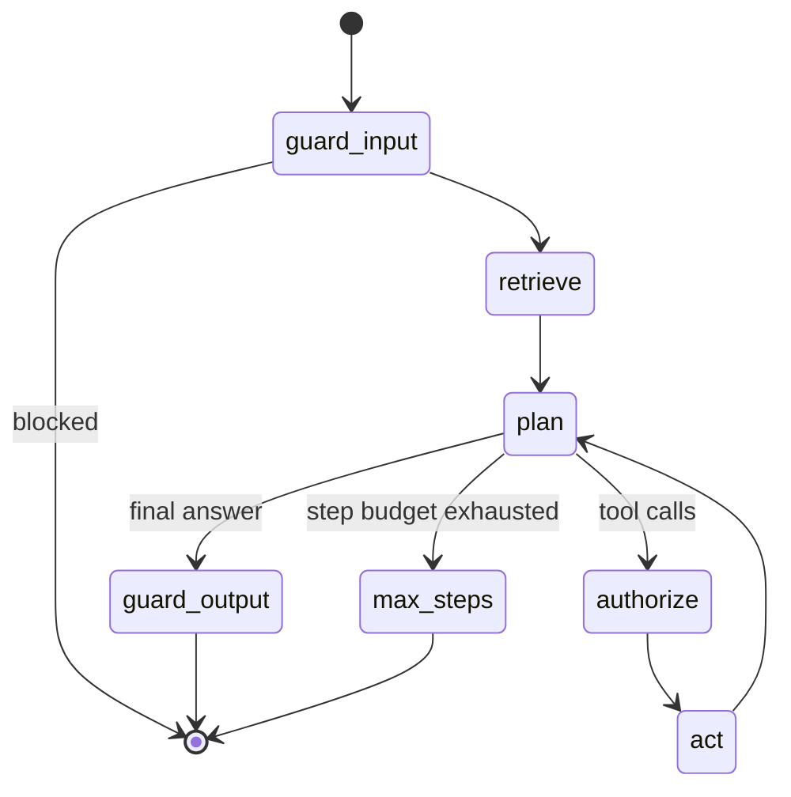

# Agent layer

The agent is a LangGraph `StateGraph` defined in `sciagent/agent/graph.py`.

## Nodes

| Node | Responsibility |
|---|---|
| `guard_input` | Prompt-injection, PII and length checks; blocked runs end immediately and are audited |
| `retrieve` | Top-k catalog/tool documents from the vector store into the system prompt |
| `plan` | One LLM call with OpenAI-style tool schemas; records token usage |
| `authorize` | Policy decision per call (role, group, classification, budget, row limits) + audit |
| `act` | Executes allowed calls through the `ToolGateway`; errors become tool messages |
| `guard_output` | PII redaction and numeric grounding against tool outputs |

## LLM backends

- **vLLM** (`SCIAGENT_LLM_BACKEND=vllm`): OpenAI-compatible chat completions with
  `tool_choice=auto`. The served model is configured in the Helm values.
- **Rule-based planner** (default locally and in CI): deterministic intent routing and
  templated summaries. It is the reference agent for the regression suite, which keeps CI
  fast and free of GPU dependencies while the LLM-judge run uses staging.

## Tool gateways

`LocalToolGateway` calls the registry in-process. `McpToolGateway` routes each tool to its
domain's MCP server over Streamable HTTP. Both share the same registry for schemas, so a
tool is defined once and validated identically regardless of transport.
