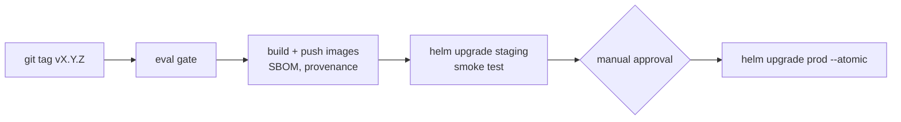

# Deployment

## Environments

| Env | Cluster | Node groups | Notes |
|---|---|---|---|
| dev | `sciagent-dev` | system, cpu-workers, gpu-inference (min 0) | single NAT, scale-to-zero GPUs |
| staging | `sciagent-staging` | as prod, smaller | receives every release first |
| prod | `sciagent-prod` | system, cpu-workers, gpu-inference | Multi-AZ RDS, manual approval |

Infrastructure is Terraform (`infra/terraform/envs/<env>`), applied from CI with OIDC role
assumption. Workloads are deployed with the Helm chart in `deploy/helm/sciagent`.

## Release flow

## Observability

- Metrics: `/metrics` on every service, scraped via ServiceMonitors; vLLM and DCGM exporters
  for GPU metrics.
- SLO alerts: multi-window burn-rate alerts for 99.9% API availability and p95 latency
  (`deploy/monitoring/prometheus/rules`).
- Dashboards: `deploy/monitoring/grafana/dashboards/sciagent-overview.json`.
- Logs: structured JSON with `request_id` correlation.

## GPU cost controls

- GPU nodes are tainted; only vLLM tolerates them.
- vLLM autoscales on queue depth rather than CPU, and dev scales to zero.
- The `GPUUnderutilised` alert flags nodes below 20% utilisation for an hour.
