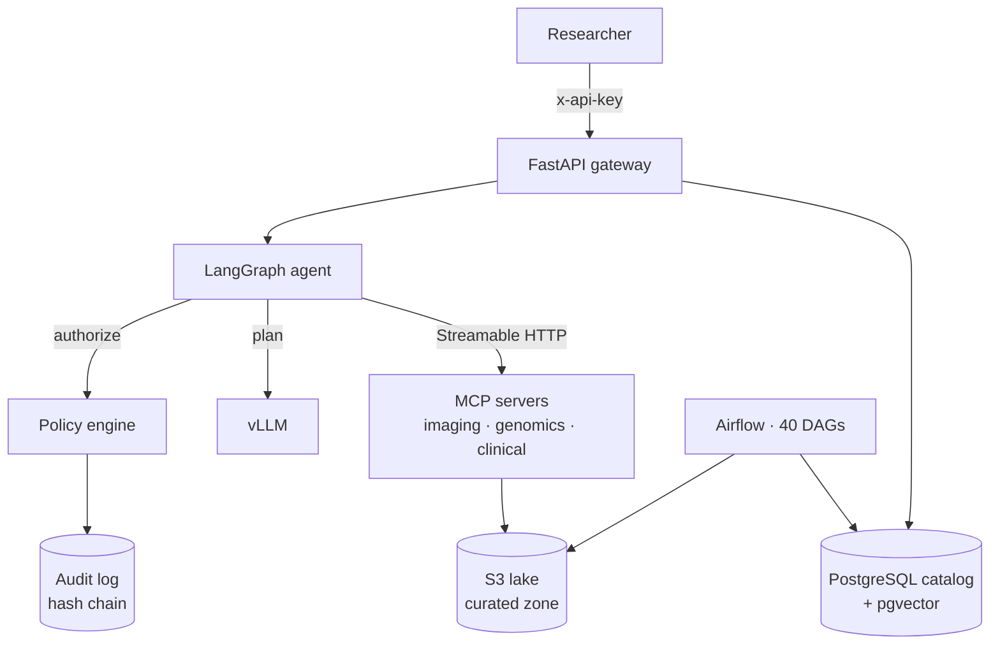

# Architecture overview



## Components

| Component | Runtime | Scales on | Notes |
|---|---|---|---|
| `api` | Deployment, 3+ replicas | CPU / RPS | Stateless; sessions are runs in PostgreSQL |
| `mcp-{imaging,genomics,clinical}` | Deployment per domain | CPU | Independent release and blast radius per domain |
| `vllm` | GPU Deployment on `g5` nodes | queue depth (`vllm:num_requests_waiting`) | Scale-to-zero in dev |
| Airflow | KubernetesExecutor | tasks | DAGs generated from `pipelines.yaml` |
| PostgreSQL 16 | RDS Multi-AZ | — | catalog, runs, audit, `embeddings` (pgvector HNSW) |
| S3 | raw / curated / artifacts buckets | — | SSE-KMS, versioning, lifecycle tiers |

## Request lifecycle

1. The API authenticates the key, creates an `agent_runs` row and invokes the agent.
2. The agent runs input guardrails, retrieves catalog context, and asks the LLM to plan.
3. Each proposed tool call is evaluated by the policy engine and written to the audit log.
4. Allowed calls go through the gateway (MCP in cluster); results are appended to the
   conversation and the agent plans again, up to `agent_max_steps`.
5. Output guardrails redact PII and flag ungrounded numbers; the run is persisted with all
   steps, token counts and latency.

## Package map

```
sciagent/
  api/          FastAPI app, routers, middleware, dependency container
  agent/        LangGraph graph, tool gateways, prompts
  tools/        tool registry and the 8 scientific tools
  mcp_servers/  MCP server factory + entry points
  governance/   policy engine, guardrails, audit log, policies.yaml
  catalog/      SQLAlchemy models and repositories
  data/         synthetic sources, harmonisation, lake I/O, pipelines
  retrieval/    embeddings and vector stores
  llm/          vLLM client, rule-based planner
  eval/         task schema, runner, judges, release gate
```
